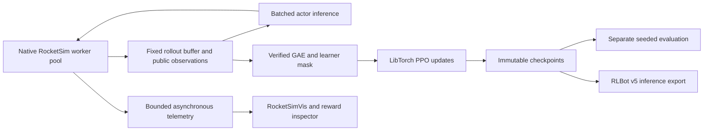

# DuelForge — new 1v1 bot, Phase 1 architecture proposal

Status: research and bounded feasibility probes completed. No competitive training run, trained bot or live RLBot deployment is claimed in this package. This project is separate from attention_skills, gigaforge and the replay projects. Their models, rewards and experiment directories are not inherited.

## Recommendation

Start with a pinned RocketSim C++ environment and a small, audited GigaLearn-derived LibTorch PPO pipeline. Use a fresh Octane 1v1 policy, separate 512×512×512 actor and critic, LayerNorm/ReLU, FP32 and the existing 90-action table. The prototype model contains **1,216,091 parameters total**, of which the deployed actor contains 630,874. The initial observation contract is GGL AdvancedObs: 109 floats for 1v1, including ball spin, previous controls, boost-pad availability/cooldowns, both cars' orientations/velocities and jump/flip status. Verify the length and every feature against the actual builder before training; a matching length alone is insufficient.

This is the proposed baseline, not a finding that PPO or MLPs are universally strongest. The decision favors useful experience per wall-clock hour, predictable 4 GB VRAM use and a straightforward RLBot v5 inference path. The selected stock GigaLearn archive is **not ready to train unchanged**: two GAE faults were reproduced, and rollout boundaries/opponent switching still need the checks below. The supplied minimal GAE patch fixes the two isolated reproductions; it does not certify the entire learner.

Do not rebuild a general-purpose RL framework. Reuse RocketSim, the native environment/action/observation infrastructure, LibTorch's numerical kernels and the existing GGLBot v5 client. Confine changes to contract correctness, fixed rollouts, episode-boundary opponent assignment and project-specific rewards/telemetry. Python may handle launchers, reports and W&B outside the per-arena simulation loop.

## Source checks and stack comparison

Exact commits are recorded in research/repositories.json. Repository features below were inspected in README and relevant source files; they are not all build-tested.

| Candidate | What the source establishes | Decision / unresolved test |
| --- | --- | --- |
| RocketSim main, c2baacb | C++ engine, native car/ball state and configurable ball rotation | Primary simulator; pin meshes and physics revision, never silently update |
| GigaLearnCPP-Leak, 86e11c3 | Native batched collection, LibTorch, masks, model versions, historical-opponent code, configurable action delay; archived repository | Primary baseline candidate after correctness repairs. Advertised speedups are author-machine results, not our laptop results |
| RLGymPPO_CPP, ee4cc56 | Earlier C++ PPO, multithreaded collection and checkpoint converter | Reference/backup. Its author states development moved to GigaLearn; no reason to migrate to this older learner merely because a guide says 5× |
| rlgymppo_rs, c774b30 | Burn 0.22, native environment pools, row-aligned GAE tests, saved opponents, Nexto evaluation, distillation and RLBot v5 crate | Strong alternative. Current source uses RocketSim v3/RLGym-rs and a newer toolchain; benchmark the whole stack and verify GTX 1650/backend/export compatibility before switching |
| rlgym-learn, 2503793 | RLGym v2 + Rust/shared-memory coordination, Windows/Linux, separate algorithm package | Useful independent correctness/reference implementation; remaining Python environment/reward overhead must be measured |
| Python RLGym / rlgym-ppo | Clear reference APIs and quick debugging | Reference tests, not the preferred per-arena hot path on this CPU |

The GigaLearn README says older-version training is “coming soon,” but Learner.cpp and LearnerConfig.h implement it. Source also notes that switching opponents can disturb gameplay; new opponent assignments must occur at episode boundaries. The Rust source's GAE reference explicitly consumes truncation values in reverse boundary order, unlike the inspected archive. These are reasons to inspect implementations rather than compare README feature lists.

Framework selection gate: a reproducible short benchmark must include physics, observations, masks, reward computation, inference, transfers, GAE and optimizer updates. If native C++ correctness repairs expand beyond these bounded components, or the Rust stack gives materially better complete throughput under the same model/contract, select Rust instead. Do not replace the stack on the basis of language or raw simulator TPS alone.

## Algorithm comparison

| Approach | Expected benefit | Why it is / is not first |
| --- | --- | --- |
| PPO | Fresh on-policy data, masked categorical actions, compatible self-play and inexpensive small batches | Initial controlled baseline. Fixed-policy rollouts, correct timeouts and finite-gradient/KL checks are mandatory |
| Discrete SAC | Reuses expensive experience | Worth a later matched test if collection dominates; Q targets age as opponents change, replay storage and extra networks add work. The cited 2026 SAC paper studies legged robots, not Rocket League self-play |
| TD3 / continuous SAC | Smooth analog actions | Hybrid jump/boost/handbrake semantics and action timing need a new controlled design; they are not automatically stronger than 90 discrete choices |
| Replay BC / offline RL | A reliable prior could reduce random exploration | Optional after label/contract audit. Replay reconstruction is not exact ground-truth control. Split by complete replay, retain provenance/confidence, resimulate held-out action chunks and exclude future fields from policy inputs |
| Auxiliary prediction / KRC | Lucy-SKG provides evidence worth testing | Later ablation, one addition at a time. Do not claim its historical results transfer to this laptop or new opponent pool |
| Search / MPC | Could improve decisions given a calibrated policy and value function | Defer until the policy scores reliably. Compare 1/4/8 candidates and 0.25–1 s rollouts, including CPU cost and model error. A fresh value head is not a reliable evaluator; 64 candidates are not a default |
| Large populations / hierarchical control | Strategic diversity | Frozen snapshots first. Several simultaneously training bots divide this laptop's learning budget and complicate attribution |

Primary sources: [PPO](https://arxiv.org/abs/1707.06347), [SAC](https://arxiv.org/abs/1801.01290), [parallel SAC in locomotion](https://arxiv.org/abs/2605.24975), [Lucy-SKG](https://arxiv.org/abs/2305.15801), [Seer](https://nevillewalo.ch/assets/docs/MA_Neville_Walo_Seer_RLRL.pdf), [replay-pretraining](https://github.com/Rolv-Arild/replay-pretraining). The prompt's [PPO-MCTS paper](https://arxiv.org/abs/2309.08611) is about air-combat maneuvering, so it supplies a research idea, not a Rocket League result. The [sim-to-sim paper](https://arxiv.org/abs/2205.05061) demonstrates specialized striker/goalie transfer, not a complete strong 1v1 agent.

## Architecture and timing

- Physics: 120 Hz. Initial policy decisions: every 8 physics ticks (15 Hz). Initial action delay: 7 ticks to match the inspected GGL/GGLBot default. Both are explicit, versioned contract fields; do not reuse the old AttentionForge one-tick-delay setting silently.
- RLBot still returns/holds controls on every available tick. A 15 Hz policy does not mean the client can block for 66 ms. Target p99 control callback <8.33 ms at 120 FPS, record missed ticks and benchmark inference under the real game load. [RLBot tick-rate documentation](https://wiki.rlbot.org/v5/botmaking/tick-rate/).
- GGLBot's `POLICY.lt`/optional shared-head files are native LibTorch model archives. A TorchScript file renamed `.lt` is not automatically compatible. Export must use the intended loader, identical LayerNorm/activation/feature order, and match source logits/actions. A separate `.pt` wrapper is optional; neither renaming nor matching tensor dimensions is conversion.
- Octane training and deployment. Fixed opponents retain their own documented hitboxes and timing: Chronos normally Breakout, Galactus V2 Octane. No shared observation builder is assumed between unrelated bots.
- Keep game score/time in evaluation even when training episodes reset after goals. If later adding a match-time strategy head, explicitly version observation changes.

## Rollout and checkpoint correctness gates

1. Use fixed T×arenas×players rollouts. Freeze learner weights throughout collection. Preserve every tail with its own bootstrap observation; do not carry stale fragments across policy updates.
2. Goals are true terminals: next value zero. Artificial timeouts bootstrap from the physical state BEFORE reset; advantages do not cross resets. Finite rollout boundaries also need explicit bootstrap values.
3. Exclude frozen-opponent transitions from the PPO loss and from the learner-transition count. Record physical ticks, arena decisions, total player decisions, collected learner transitions and consumed minibatch samples separately.
4. Apply masks consistently to sampling, log probability and entropy. Never blanket-mask jump/aerial combinations merely because the car is grounded. Test action ordering, blue/orange rotations and the full delay queue.
5. Test deterministic seeded physics and per-arena random streams, observation parity and frozen-opponent action parity. Changing worker count must not silently change the declared evaluation seeds.
6. Save model, optimizer, RNG states, config, hashes and counters atomically. New experiments get new directories; evaluated actors are pinned by content hash and protected from checkpoint rotation. Simulator episodes may restart on resume; record that limitation rather than claiming bit-exact uninterrupted continuation.

## Laptop starting settings

Start 64 arenas, compare 128 only after measuring. Benchmark 1/2/3 simulator workers and 1/2 Torch CPU threads; leave CPU capacity for Windows. Start with 256 decisions per arena per rollout, two PPO epochs, minibatches 1024 or 2048 selected by profiling, Adam LR 1e-4, gamma .995, lambda .95 and clip .2. Define entropy in unnormalized nats, begin coefficient .01 and log legal-action entropy / maximum legal entropy; do not transplant a normalized GGL entropy coefficient without conversion. Stop the update if measured KL exceeds .02; log actual optimizer steps.

These are starting hypotheses, not tuned settings. Use FP32 first. FP16 is a benchmark candidate with finite/logit/gradient checks; do not assume it speeds up GTX 1650. BF16 is not a default on this GPU. Keep rollout storage on the host initially, then compare a bounded GPU cache. Use CUDA allocation/reservation measurements and optional process-level GPU sampling, not Task Manager's default 3D graph.

Model/Adam/gradient tensors for 1.216M FP32 parameters are about 19.5 MB excluding activations and library workspace. A 32,768-transition rollout with 109 FP32 features, 90 mask bytes and scalar fields is roughly 20 MB of host arrays. These arithmetic estimates do not include CUDA context, temporary tensors, simulator arenas or the game. Admission targets: <2.5 GiB measured CUDA allocation, <3 GiB reservation, <8 GiB trainer RSS; reduce batch/arena count before approaching limits. No enforced thermal sensor is claimed on hardware where a trustworthy sensor is unavailable; use sustained throughput and available GPU temperature telemetry and provide a low-impact preset.

## What was actually measured

See results/server_model_probe.json: Linux CPU, PyTorch 2.9.1+cpu, two Torch threads, synthetic tensors. The 1.216M dense model processed ~12.2k examples/s for forward/backward/Adam at batch 1024 versus ~3.9k for the 1.231M four-token attention comparator. Batch-256 actor+critic inference was ~53.6k versus ~15.4k examples/s. These short probes establish code paths and relative cost on THIS CPU, not GTX 1650 speed, end-to-end SPS, learning quality or competitive strength.

The warmed serial Python RocketSim-binding probe records physics-only results. It excludes rewards, observations and learning and does not benchmark GGL's worker pool. A preliminary `Arena.multi_step` probe degraded badly with many arenas; do not equate more arenas or a native entry point with efficient CPU parallelism. Benchmark the actual bounded worker pool.

## Approval boundary and next experiment

See FIRST_EXPERIMENT.json. Proposed total pilot budget is 90 minutes on the laptop: at most 10 minutes profiling, 20 minutes contract/integration checks and six 10-minute learning blocks (two reward arms, three paired seeds). Run sequentially, not six trainers at once. Stop early on contract failure, nonfinite updates or resource pressure. No unapproved overnight run follows.

The pilot asks whether fresh policies discover useful contacts/scoring and whether the small impulse bootstrap helps without reducing independent match performance. It is not expected to establish superiority over Nexto or strong humans in 90 minutes. If source repairs or build compatibility prevent a correct bounded pilot, report that blocker rather than silently train a substitute implementation.

## Sample budget reality

At a hypothetical sustained **20k consumed learner transitions/s**, one billion transitions takes 13.9 hours; at 40k/s it takes 6.9 hours. Fourteen billion takes about 8.1 or 4.1 days respectively, before extra evaluation/down time. These are arithmetic scenarios, not measured laptop forecasts. Physical ticks/s, two-car actions/s and minibatch examples/s must not be substituted into this calculation. A stronger GPU in an anecdotal Discord run and a different “steps” definition can explain very different reported training times.
